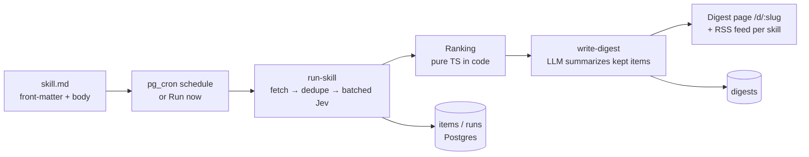

# Morning Brief

A daily research agent driven by markdown skills. You write a "skill" as a markdown file — a topic, sources, what counts as relevant, and the output format. A scheduled agent (Supabase `pg_cron`) runs every skill each morning: it fetches fresh items from the skill's sources, **Jev** (TypeSafe AI's fast decision model) scores each item for relevance, novelty, and quality in batched requests, code picks the keepers, and the LLM summarizes only those into a published digest page.

**Fetch wide, Jev filters cheaply, the LLM writes only what matters.**

## Overview

- Skills are markdown documents with YAML front-matter (`sources`, `schedule`, `keep`) and body sections (`## What I care about`, `## Skip`, `## Output`), stored in Postgres and editable in the app.
- Each run: fetch → dedupe (URL + title similarity) → 14-day novelty prefilter → batched Jev scoring (10 items/request) → pure-TS ranking → `write-digest` → public digest page.
- Three example skills ship seeded: "AI agents digest", "Indie hacker news", "New arXiv papers on LLM evals".
- Offline replay bundles one recorded run per example skill (items, Jev responses, digest) so the full pipeline — including the real ranking code — runs with zero API calls.

## Pipeline



## Rules & scope

- **Read-only, polite fetching.** Only `GET` from public sources listed in the skill: RSS/Atom feeds, the Hacker News Algolia API (`https://hn.algolia.com/api/v1/search_by_date`), arXiv's API (`http://export.arxiv.org/api/query`), and Reddit public `.json` listings. No logins, no scraping behind paywalls, and no following arbitrary links beyond fetching an item's page `<title>`/meta description when a feed lacks a summary. Max 60 items per skill per run, max 20 outbound fetches per run (sources + item-page fallbacks), 2 MB per response (streamed and enforced), 20 s per source.
- **SSRF guard on every fetched URL:** http/https only; trailing dots stripped; blocks localhost, metadata hosts, `.internal`/`.local`, single-label hosts, credentials in URLs and non-standard ports; blocks private, loopback, link-local, CGNAT, multicast/reserved IPv4 and every IPv6 address outside global unicast (incl. all `::ffff:` mapped, `fc00::/7`, `fe80::/10`, `::`). The hostname is resolved (A + AAAA) on every hop and rejected if any answer is private; DNS failure fails closed. Max 3 redirects, re-checked each hop. Reddit sources must be on `reddit.com` / `www.reddit.com` / `old.reddit.com`.
- **Untrusted content.** Fetched text is wrapped as data in every Jev and LLM call; instruction-like text is flagged (never obeyed).
- **Daily cap.** Every paid upstream call is reserved in `usage_counters(fn, day, calls)` via the service-role-only `increment_usage_by` function, **200 per function per day** (override with the `DAILY_CALL_LIMIT` secret). Each Jev request — every batch and every retry — is counted right before it is sent; over the cap, Jev stops and the keyword fallback scores the rest. `write-digest` counts its single OpenAI call. Each run and each new skill is also counted. Counter errors fail closed (503); over the cap returns a friendly 429 ("Demo daily limit reached - Offline demo still works").
- **Small deploys.** Three Edge Functions (`run-skill`, `write-digest`, `save-skill`), all with `verify_jwt = true`. `write-digest` only accepts the service-role key (it is an internal step of `run-skill`); `save-skill` validates skill config and source URLs before writing.
- All keys stay server-side in Supabase Edge Function secrets. Nothing secret goes in the browser bundle.

## Why Jev?

Relevance filtering before an expensive LLM is the whole point. Without a cheap filter, every fetched item (dozens per skill per morning) would flow into a large-context LLM call. Jev answers many questions in one request — `item1__relevance`, `item1__skip`, `item1__substance`, `item1__kind` — for up to 10 items per batched call, at roughly $0.042 per million input tokens (output tokens free). Code then ranks and keeps only the top handful, so the LLM sees 6 items instead of 60. The Stats page shows the estimated token and cost savings next to actual Jev spend.

## Setup

```bash
# 1. Secrets (server-side only)
supabase secrets set TYPESAFE_API_KEY=... OPENAI_API_KEY=... OPENAI_MODEL=gpt-6-luna
# optional: OPENAI_BASE_URL for a compatible endpoint

# 2. Enable scheduling extensions in Supabase (SQL editor)
create extension if not exists pg_cron;
create extension if not exists pg_net;

# 3. Deploy the functions
supabase functions deploy run-skill
supabase functions deploy write-digest
supabase functions deploy save-skill

# 4. Run the app
npm install
npm run dev
```

Saving a skill with an edited schedule upserts a matching `pg_cron` job (managed by the app); "Pause" removes it and "Resume" recreates it at the same UTC time. "Run now" invokes `run-skill` directly.

## Env vars

| Variable | Where | Purpose |
|---|---|---|
| `VITE_SUPABASE_URL` | browser | Supabase project URL (public) |
| `VITE_SUPABASE_ANON_KEY` | browser | Supabase anon key (public) |
| `TYPESAFE_API_KEY` | Edge secret | Jev scoring API |
| `OPENAI_API_KEY` | Edge secret | LLM digest writer |
| `OPENAI_MODEL` | Edge secret | Writer model (default `gpt-6-luna`) |
| `OPENAI_BASE_URL` | Edge secret | Optional OpenAI-compatible base URL |
| `DAILY_CALL_LIMIT` | Edge secret | Optional daily cap per function (default 200) |

`.env.example` lists only the two `VITE_` vars.

## Screenshots


## Limitations

- Summaries come from feeds/APIs, not full articles — the LLM writes from titles and truncated summaries only.
- Dedupe is simple: normalized URL plus token-overlap title similarity, not embedding-based.
- One public demo workspace; no auth, no multi-tenant isolation.
- Cron parsing supports the common 5-field subset (`*`, lists, ranges, steps).
- The 200 calls/day cap is per function per calendar day (UTC), shared by all demo visitors.

## Design decisions

- **Ranking in code, not in the model.** The score formula (`relevance/4 × 0.55 + substance/4 × 0.35 + novelty × 0.10`, times `(1 − skip_p)`) lives in plain TypeScript so it's inspectable, deterministic, and unit-test friendly. Jev judges; code decides.
- **Batched Jev questions.** One HTTP call carries up to 10 items × 4 questions, namespaced `item{n}__{q}` — dramatically cheaper and faster than per-item requests.
- **Template writer fallback.** If `OPENAI_API_KEY` is missing or the LLM output fails validation, a deterministic template digest is built from ranked titles, so a digest always publishes. Jev still runs live in mock mode.
- **Citation enforcement.** Every digest bullet must cite one of the input URLs; code drops any bullet whose URL isn't in the input set.
- **Read-only anon access.** The demo is a single public workspace with no sign-in: anon can read skills, runs, items and digests, but has no INSERT/UPDATE/DELETE. All writes go through Edge Functions using the service-role client with whitelisted columns and bounded payloads; `usage_counters` and `app_config` are not readable by anon at all.

## Scheduling configuration

Migrations contain no project token. Supply app.settings.supabase_url and
app.settings.anon_key in the migration session through your deployment tooling,
or populate the owner-only public.app_config rows supabase_url and anon_key
in the SQL editor using values from your own project. Never paste those values
into tracked SQL. The browser separately reads the two public VITE_ variables.
Missing migration settings leave existing configuration unchanged; configure both
rows before enabling schedules. This change does not reconfigure a deployed project.

Earlier Git revisions contained public anon-role tokens. Existing history is
retained; replacing the current source does not revoke those tokens. Project owners
should review exposure and key rotation in their deployment separately.
